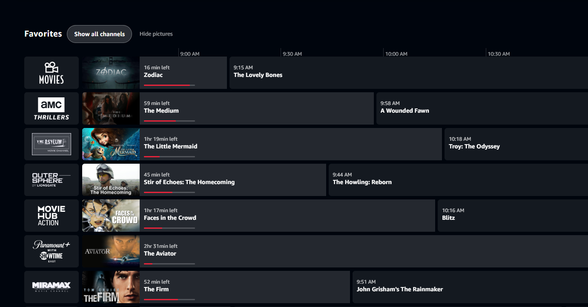

# Prime Video Live TV - Favorites Only

A Tampermonkey userscript that adds a **favorites-only TV guide** to Amazon Prime Video's Live TV page.

Prime Video offers hundreds of live channels, but its desktop website doesn't provide a convenient way to browse only your favorite stations. This script creates a separate, fully functional program guide containing just the channels you've favorited.

No more scrolling through hundreds of channels to find the ones you actually watch.

## Screenshot

## Features

- **Favorites-only guide** - Displays your favorited Live TV channels in one place.
- **Full program schedules** - Shows what's currently playing and what's coming up over a three-hour timeline.
- **Live playback** - Click a channel logo or program to start watching through Prime Video's native player.
- **Program thumbnails** - Displays artwork for currently airing programs, with an option to hide pictures.
- **Proportional timeline** - Program blocks reflect their actual start times and durations.
- **Progress indicators** - See how much of the current program has elapsed and how much time remains.
- **Persistent channel ordering** - Keeps your channels in a consistent order even when Amazon changes its listings.
- **Remove favorites** - Unfavorite channels directly from the custom guide.
- **Automatic background updates** - Refreshes channel and schedule information without reloading the page under normal conditions.
- **Show all channels** - Switch between the custom favorites guide and Amazon's original channel listing.
- **Local caching** - Restores previously retrieved favorites while fresh data loads.

## Requirements

- A browser compatible with Tampermonkey
- [Tampermonkey](https://www.tampermonkey.net/) or a compatible userscript manager
- Access to [Amazon Prime Video](https://www.primevideo.com/) and its Live TV guide

Developed and tested using a Chromium-based browser.

## Installation

1. Install Tampermonkey in your browser.
2. Open the `prime-video-favorites.user.js` file in this repository.
3. Copy its contents into a new Tampermonkey userscript and save it.
4. Navigate to [Prime Video Live TV](https://www.primevideo.com/livetv).
5. Allow the script to load and scan your channels.

The initial scan may take some time because the script retrieves channel information across the full guide.

Once complete, your favorites will appear in a new section above Amazon's original station listing.

## Usage

### Favorites Only / All Channels

Use **Show all channels** to display Amazon's original Live TV guide.

Select **Show favorites only** to return to the custom guide.

### Watching a channel

Click a channel logo or any of its program blocks to start the live stream.

Clicking a future program starts the channel's current live broadcast; it does not schedule playback of that future program.

### Program artwork

Use **Show pictures / Hide pictures** to toggle program thumbnails.

With pictures enabled, the guide reserves a dedicated area for the currently airing program while keeping upcoming programs aligned to the timeline.

### Managing favorites

Favorite channels using Prime Video's existing controls. The script reads your favorite status and includes those stations in the custom guide.

You can also remove favorites directly from the custom guide.

### Automatic updates

The script periodically checks whether its schedule data is becoming outdated.

When needed, it retrieves fresh information in the background, preserving your current page and channel ordering.

A page reload may be used as a fallback if background updating fails.

## How It Works

Prime Video's Live TV interface loads channel information through a paginated data system.

The script accesses the page's existing React application context to retrieve station information, favorite status, schedules, and playback actions.

It then:

1. Retrieves the initial station data.
2. Paginates through the available channel listings.
3. Identifies favorited stations, including favorites in Recently Watched.
4. Builds a separate program guide using those stations.
5. Uses Prime Video's native playback functionality when a channel is selected.

For background updates, the script fetches the Live TV page's server-provided hydration data and uses its fresh pagination information to retrieve updated schedules.

The guide's display preferences and cached data are stored locally in the browser.

**The script does not provide video streams or bypass Prime Video's playback or access requirements.** Playback remains handled by Amazon.

## Limitations

- The script depends on Prime Video's internal page structure and APIs, which Amazon may change without notice.
- It is intended for Prime Video's desktop Live TV interface.
- Available channels and program schedules vary by region and account.
- Schedule information is limited to what Prime Video provides.
- The initial channel scan can take some time.
- Background updates depend on Prime Video continuing to expose compatible data.

## Planned Features

Potential future improvements include:

- Drag-and-drop channel reordering
- Timeline navigation and adjustable time ranges
- Custom channel groups
- Filtering by program type or genre, where metadata permits
- Expanded program information
- Optional reminders for upcoming programs
- Alternative browsing layouts, including an On Now view
- Exporting and importing settings

These are ideas under consideration, not guaranteed features.

## Disclaimer

This is an independent, unofficial project and is not affiliated with, endorsed by, or supported by Amazon.

Amazon, Prime Video, and related names are trademarks of their respective owners.

This userscript is provided as-is and may stop working if Prime Video changes its website or internal APIs.

## Contributing

Bug reports, suggestions, and improvements are welcome.

If you encounter a problem, please include your browser, userscript manager, and a description of what happened. Console messages prefixed with `[pvfav]` may be useful for troubleshooting.

## License

*License to be determined.*
